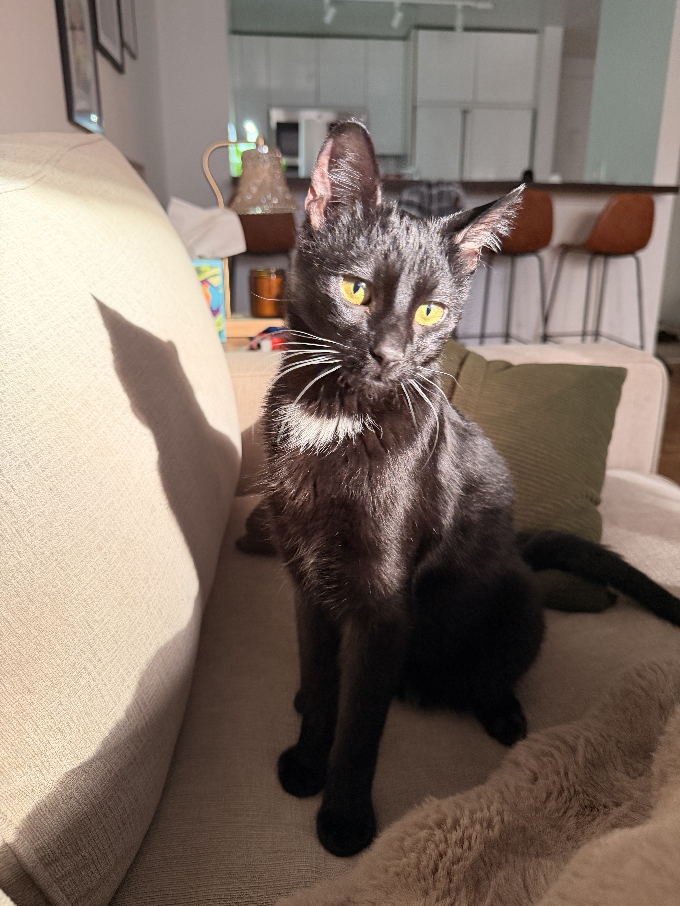

<h3 align="center">
    <a href="#getting-started">Getting Started</a>
    <span> · </span>
    <a href="#why-use-agentcat-">Features</a>
    <span> · </span>
    <a href="https://docs.agentcat.com">Docs</a>
    <span> · </span>
    <a href="https://agentcat.com">Website</a>
    <span> · </span>
    <a href="#free-for-open-source">Open Source</a>
    <span> · </span>
    <a href="https://meet.agentcat.com/meet">Schedule a Demo</a>
</h3>
<p align="center">
  <a href="https://central.sonatype.com/artifact/com.agentcat/agentcat-java-sdk"></a>
  <a href="https://opensource.org/licenses/MIT"></a>
  <a href="https://www.java.com"></a>
  <a href="https://github.com/agentcathq/agentcat-java-sdk/issues"></a>
  <a href="https://github.com/agentcathq/agentcat-java-sdk/actions"></a>
</p>

> [!NOTE]
> AgentCat v2 introduces compatibility with the [MCP Protocol "Stateless" 2026-07-28 Update](https://blog.modelcontextprotocol.io/posts/2026-07-28/) and the `McpStatelessSyncServer` / `McpStatelessAsyncServer` server types that put it into effect. The stateless transition has a massive impact on analytics, as sessions were a built-in concept tying related tool calls together. AgentCat has now migrated its session tracking under guidance of the MCP core team's recommendations of using [explicit handles (SEP-2567)](https://github.com/modelcontextprotocol/modelcontextprotocol/pull/2567).
>
> As a result AgentCat now injects a `session_id` on every MCP tool call to associate them under the same task umbrella. Our evals show much higher tool correlation accuracy at the cost of < 1% additional context pollution.

AgentCat is an analytics platform for MCP server owners 🐱. It captures user intentions and behavior patterns to help you understand what AI users actually need from your tools — eliminating guesswork and accelerating product development all with one line of code.

```xml
<dependency>
    <groupId>com.agentcat</groupId>
    <artifactId>agentcat-java-sdk</artifactId>
    <version>0.1.0</version>
</dependency>
```

To learn more about us, check us out [here](https://agentcat.com). For detailed guides visit our [documentation](https://docs.agentcat.com).

## Why use AgentCat? 🤔

AgentCat helps builders of MCP servers learn how to improve them by capturing agent goals and detecting when they get stuck.

Use AgentCat for:

- **Agent session replay** 🎬. Follow alongside your users and their agents to understand why they're using your MCP servers, what functionality you're missing, and what clients they're coming from.
- **Trace debugging** 🔍. See where your users are getting stuck, track and find when LLMs get confused by your API, and debug sessions across all deployments of your MCP server.
- **Existing platform support** 📊. Get logging and tracing out of the box for your existing observability platforms (OpenTelemetry, Datadog, Sentry) — eliminating the tedious work of implementing telemetry yourself.

## How it works

AgentCat works as a lightweight middleware inside your MCP server. When you call `track()`, it seamlessly modifies your registered tool schemas in place, following the MCP core team's [explicit handles (SEP-2567)](https://github.com/modelcontextprotocol/modelcontextprotocol/pull/2567) guidelines. Concretely, AgentCat adds the following to your server:

- **`session_id`** — a parameter injected into each tool's input schema. Agents echo it back on every call, letting AgentCat group related tool calls into one task even over stateless transports. Values are validated: anything AgentCat did not issue is rejected rather than adopted, and the agent is told to re-send the ID it was given.
- **`agent_id`** _(off by default)_ — enabled with `setEnableAgentTracking(true)`. Each agent self-generates its own ID, keeping parallel agents working the same task individually attributable.
- **`context`** — a parameter asking the agent to explain, in one sentence, why it is making this call. This is where intent data comes from.
- **`get_more_tools`** — an additional tool, prompt-engineered so that agents readily report the features and tools they looked for but couldn't find — surfacing your missing functionality directly from real usage.

Injected parameters are stripped from arguments before your tool handler runs, so your code never sees them. For tools that declare an output schema, issued IDs are also mirrored into `structuredContent` (as `_mcp_instructions`), so clients that only read structured results still receive them.

## Getting Started

To get started with AgentCat, first create an account and obtain your project ID by signing up at [agentcat.com](https://agentcat.com). For detailed setup instructions visit our [documentation](https://docs.agentcat.com).

Once you have your project ID, integrate AgentCat into your MCP server:

```java
import com.agentcat.sdk.AgentCat;
import io.modelcontextprotocol.server.McpServer;
import io.modelcontextprotocol.server.McpSyncServer;
import io.modelcontextprotocol.spec.McpSchema;

McpSyncServer server = McpServer.sync(transport)
        .serverInfo("echo-mcp", "0.1.0")
        .toolCall(
            McpSchema.Tool.builder("echo")
                .description("Echo a message")
                .inputSchema(McpSchema.JsonSchema.builder()
                    .type("object")
                    .properties(Map.of("msg", Map.of("type", "string")))
                    .build())
                .build(),
            (exchange, request) -> {
                String msg = (String) request.arguments().get("msg");
                return McpSchema.CallToolResult.builder().addTextContent(msg).build();
            })
        .build();

// Track the server with AgentCat
AgentCat.track(server, "proj_0000000");
```

Stateless servers built on [MCP 2026-07-28](https://blog.modelcontextprotocol.io/posts/2026-07-28/) create a fresh server instance per request. Call `track()` inside the factory so every instance is tracked:

```java
import com.agentcat.sdk.AgentCat;
import io.modelcontextprotocol.server.McpServer;
import io.modelcontextprotocol.server.McpStatelessSyncServer;

// In your request handler / servlet:
McpStatelessSyncServer server = McpServer.statelessSync(transport)
        .serverInfo("echo-mcp", "0.1.0")
        .toolCall(echoTool, echoHandler)
        .build();

AgentCat.track(server, "proj_0000000");
```

Calling `track()` per instance is cheap — the event queue is initialized once and shared across instances.

`track()` returns the same server instance so it can be chained inline. `McpSyncServer`, `McpAsyncServer`, `McpStatelessSyncServer`, and `McpStatelessAsyncServer` are all supported.

### Identifying users

We strongly encourage identifying every actor. If you can't resolve a real user, return a stable anonymized ID instead — for example, a hash of the auth token or API key — so that all events from the same end user still roll up to one actor in your dashboard rather than scattering into anonymous one-off sessions.

`identify` (like every AgentCat hook) runs concurrently with your tool handler and never adds latency to tool calls: a slow lookup — or a hook that fails outright — costs analytics data for that event, never your tool's response time.

```java
AgentCat.track(server, "proj_0000000", new AgentCatOptions()
    .setIdentify((request, extra) -> CompletableFuture.supplyAsync(() -> {
        String token = extractToken(extra);
        User user = myApi.getUser(token);
        return user != null
            ? new UserIdentity(user.getId(), user.getName(), Map.of("plan", user.getPlan()))
            : null;
    }))
);
```

### Redacting sensitive data

AgentCat redacts all data sent to its servers and encrypts at rest, but for additional security, it offers a hook to do your own redaction on all text data returned back to our servers.

```java
AgentCat.track(server, "proj_0000000", new AgentCatOptions()
    .setRedactSensitiveInformation(text ->
        CompletableFuture.completedFuture(myRedact(text)))
);
```

For redaction decisions that need more context than a single string — such as which tool was called or what type of event is being published — use the event-level `redactEvent` hook. It receives the full event map and returns a modified event, or `null` to drop the event entirely:

```java
AgentCat.track(server, "proj_0000000", new AgentCatOptions()
    .setRedactEvent(event -> {
        // Drop events from tools that handle secrets entirely
        if ("get_credentials".equals(event.get("toolName"))) {
            return CompletableFuture.completedFuture(null);
        }
        // Strip response payloads from a specific tool
        if ("export_report".equals(event.get("toolName"))) {
            event.remove("response");
        }
        return CompletableFuture.completedFuture(event);
    })
);
```

### Internal diagnostics

> [!NOTE]
> Internal diagnostics (anonymous SDK error reporting to AgentCat) are coming soon to the Java SDK.

## Framework Integration

### Spring Boot

Add the dependency — no code changes required. AgentCat auto-configures itself when `agentcat.project-id` is set:

```yaml
# application.yml
agentcat:
  project-id: proj_your_project_id
  enable-agent-tracking: false      # optional, default: false
  enable-tool-call-context: true    # optional, default: true
```

The auto-configuration detects any `McpSyncServer`, `McpAsyncServer`, `McpStatelessSyncServer`, or `McpStatelessAsyncServer` bean in the Spring context — including those created by the [Spring AI MCP Server starter](https://docs.spring.io/spring-ai/reference/api/mcp/mcp-server-boot-starter-docs.html) — and wraps it automatically.

To customise hooks, declare an `AgentCatOptions` bean:

```java
@Bean
public AgentCatOptions agentCatOptions() {
    AgentCatOptions opts = new AgentCatOptions();
    opts.setIdentify((req, ctx) -> CompletableFuture.completedFuture(
        new UserIdentity(getCurrentUserId(), null, null)
    ));
    return opts;
}
```

### Quarkus

Add the dependency — no code changes required. AgentCat activates on startup when `agentcat.project-id` is set:

```properties
# application.properties
agentcat.project-id=proj_your_project_id
agentcat.enable-agent-tracking=false
agentcat.enable-tool-call-context=true
```

The listener picks up any `McpSyncServer`, `McpAsyncServer`, `McpStatelessSyncServer`, or `McpStatelessAsyncServer` CDI bean and wraps it with `AgentCat.track()` automatically.

To customise hooks, declare an `AgentCatOptions` bean:

```java
@Singleton
@DefaultBean
public AgentCatOptions agentCatOptions() {
    AgentCatOptions opts = new AgentCatOptions();
    opts.setIdentify((req, ctx) -> CompletableFuture.completedFuture(
        new UserIdentity(getCurrentUserId(), null, null)
    ));
    return opts;
}
```

### Micronaut

Add the dependency — no code changes required. AgentCat activates when `agentcat.project-id` is set:

```yaml
# application.yml
agentcat:
  project-id: proj_your_project_id
  enable-agent-tracking: false
  enable-tool-call-context: true
```

The listener intercepts `McpSyncServer`, `McpAsyncServer`, `McpStatelessSyncServer`, and `McpStatelessAsyncServer` bean creation and wraps each with `AgentCat.track()` automatically.

To customise hooks, declare a replacement bean:

```java
@Factory
public class MyAgentCatOptionsFactory {

    @Singleton
    @Replaces(bean = AgentCatOptions.class, factory = AgentCatMicronautDefaultOptions.class)
    public AgentCatOptions agentCatOptions() {
        return new AgentCatOptions()
            .setIdentify((req, ctx) -> CompletableFuture.completedFuture(
                new UserIdentity(getCurrentUserId(), null, null)
            ));
    }
}
```

## Logging

All SDK diagnostics are written to `~/agentcat.log`. Nothing is written to stdout or stderr — stdio-based MCP transports use stdout for JSON-RPC and any output there would break the protocol.

## Requirements

- Java 17+
- `io.modelcontextprotocol.sdk:mcp` 2.0.1

## Free for open source

AgentCat is free for qualified open source projects. We believe in supporting the ecosystem that makes MCP possible. If you maintain an open source MCP server, you can access our full analytics platform at no cost.

**How to apply**: Email [hi@agentcat.com](mailto:hi@agentcat.com) with your repository link

_Already using AgentCat? We'll upgrade your account immediately._

## Community Cats 🐱

Meet the cats behind AgentCat! Add your cat to our community by submitting a PR with your cat's photo in the `docs/cats/` directory.

<div align="left">
  
  
  
</div>

_Want to add your cat? Create a PR adding your cat's photo to_ `docs/cats/` _and update this section!_
